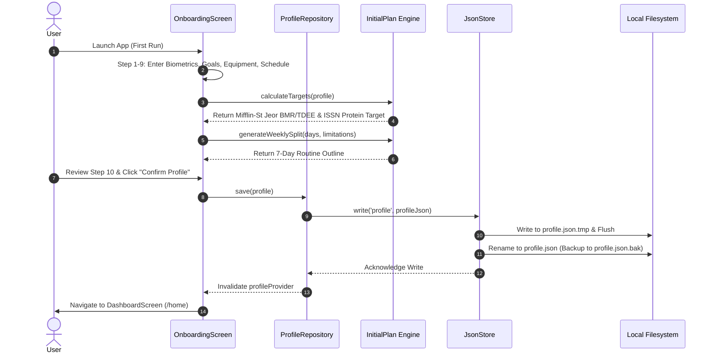
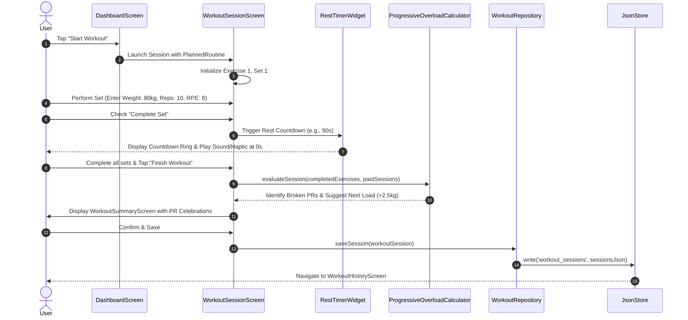
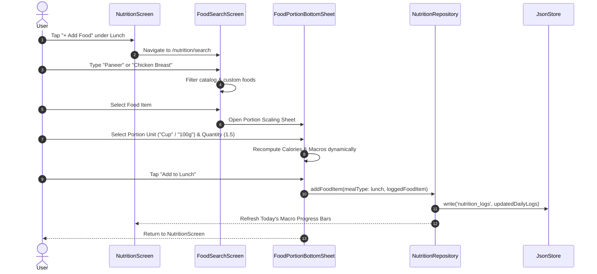
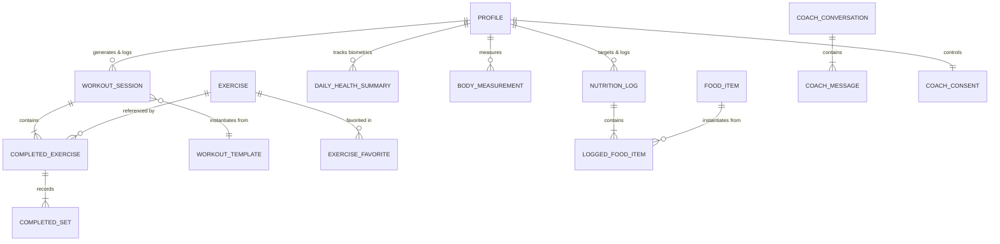

# FitForge AI — Complete Technical Project Documentation

> **Status:** Production-Ready Offline-First Architecture (Phases 1–7 Core Complete + Phase 8 Progress & Recovery Engine)  
> **Target Platform:** Cross-Platform Mobile (Android & iOS)  
> **Repository:** `fitforge_ai` (`gym_app`)  
> **Documentation Version:** 1.0.0  
> **Last Verified:** October 2026  

---

## 1. Project Overview

### 1.1 Project Name
**FitForge AI** (Package: `fitforge_ai`, Android Application ID: `com.fitforge.fitforge_ai`).

### 1.2 Purpose and Problem Statement
Mainstream fitness and wellness applications suffer from three critical architectural shortcomings:
1. **Mandatory Cloud & Internet Tethering:** Loss of cellular reception or server outages prevents users from viewing workouts, logging sets, or tracking meals in underground gyms or remote environments.
2. **Aggressive Telemetry and Privacy Erosion:** User biometric metrics, body composition, sleep architecture, and personal limitations are routinely collected, serialized, and uploaded to central advertising or cloud analytics databases.
3. **Black-Box AI Prescriptions:** AI fitness chatbots often hallucinate recommendations without clinical grounding, leak Personally Identifiable Information (PII) to remote LLM providers, and fail to provide transparent fallback mechanisms.

FitForge AI solves these problems by delivering an **offline-first, zero-telemetry, evidence-based fitness companion**. All user data—profiles, routines, workout history, nutrition logs, health metrics, and chat conversations—is persisted in **phone-private atomic JSON documents** on the device's local file system. The application operates with complete functionality offline, using validated exercise science algorithms (Mifflin–St Jeor, ISSN protein recommendations, Tanaka heart rate zones, Epley 1RM equations, double-progression overload logic, and autonomic recovery curves), while optionally enabling users to connect their own LLM API keys (**Bring Your Own Key / BYOK**) with strict zero-PII guarantees and granular consent controls.

### 1.3 Target Users and Use Cases
- **Strength & Hypertrophy Athletes:** Tracking resistance training sessions, logging sets with RPE, monitoring progressive overload, and calculating estimated 1RM without latency or connectivity needs.
- **Privacy-Conscious Individuals:** Users who refuse to transmit health biomarkers, sleep logs, or weight trends to cloud servers.
- **Gymgoers in Low-Connectivity Settings:** Basement gyms, commercial clubs with dead zones, and outdoor tracks.
- **Nutritional Trackers:** Logging meals with calibrated portion scaling from verified international databases (ICMR-NIN IFCT 2017 & USDA FoodData Central) and offline custom food entry.
- **Self-Directed Trainees:** Individuals seeking transparent, scientific explanations for their calorie targets, recovery timelines, and training splits rather than arbitrary black-box numbers.

### 1.4 Main Capabilities
- **Deterministic 10-Step Onboarding & Profile Engine:** Configures goals, training frequency, equipment, dietary preferences, clinical limitations, and generates an offline weekly split.
- **Interactive Exercise Library & 3D Anatomy:** 22 starter exercise guides with animated HD video loops, interactive front/back vector muscle map, and a fully interactive 3D push-up trainer powered by Three.js and a skinned GLB model inside an offline WebView.
- **Custom Exercise & Media Persistence:** Creation of user-defined exercises with camera/gallery photo and video attachment stored in private app sandboxes.
- **Comprehensive Workout Engine:** Interactive live session player, smart rest timer with audio/vibration cues, set logging, RPE scale (6–10), pain reporting, and automated personal record (PR) tracking.
- **Validated Nutrition Engine:** Multi-attribute catalog search (52 verified items), portion scaler, Mifflin–St Jeor BMR/TDEE calculator, ISSN protein targeter, hydration counter, and meal breakdown (Breakfast, Lunch, Dinner, Snacks).
- **Health & Sensor Aggregation:** Hardware pedometer integration, step baseline tracking, Health Connect/Apple Health permission framework with clinical justifications, and Tanaka age-predicted heart rate training zones.
- **Progress, Analytics & Recovery Engine:** Interactive body weight trend charts, weekly training volume tonnage, 1RM strength curves, autonomic muscle recovery estimates, multi-habit streak trackers (Workouts, Nutrition, Hydration), and unlocked achievement badges.
- **Dual-Engine AI Coach Station:** 100% offline rule-based heuristic coach combined with an optional multi-provider BYOK LLM engine (Google Gemini, OpenAI, Custom OpenAI-compatible endpoints) featuring at-rest XOR-salt obfuscation, immediate zeroization, and real-time raw prompt consent inspection.

### 1.5 Current Implementation Status
- **Core Architecture & Storage:** 100% Implemented (Atomic `JsonStore` with write-queuing and `.bak` self-healing).
- **Onboarding & Settings:** 100% Implemented (10-step wizard, metric/imperial switching, granular profile editing).
- **Exercise Library & 3D Trainer:** 100% Implemented (22 verified guides, SVG muscle map, Push-Up 3D trainer).
- **Workout Player & Overload Engine:** 100% Implemented (Live player, rest timer, RPE, PR calculator, history viewer).
- **Nutrition System:** 100% Implemented (Catalog repository, custom foods, meal logger, hydration).
- **Health & Biometrics:** 100% Implemented (Hardware pedometer, Tanaka zones, manual log, audit trail).
- **AI Coach (Offline & BYOK):** 100% Implemented (Heuristics, Gemini/OpenAI clients, consent inspector, obfuscation).
- **Progress & Analytics:** 100% Implemented (Interactive line charts, volume bars, recovery calculator, streaks, milestones).
- **Reminders & Local Notifications:** Partially Implemented (UI and preferences persistence implemented; background OS notification daemon pending platform-specific alarm manager wiring).
- **Cloud Synchronization & External Database:** Intentionally Excluded by Design (App is strictly zero-cloud/offline-first).

---

## 2. Technology Stack

| Category | Technology | Version | Purpose |
|---|---|---|---|
| **Programming Language** | Dart | 3.13.2 (Flutter 3.47.2 channel stable) | Primary language for client logic, repositories, and UI |
| **Scripting Language** | Python | 3.10+ (Verified) | Exercise catalog compilation and GLTF model optimization |
| **Frontend Framework** | Flutter SDK | 3.47.2 | Cross-platform UI toolkit with Material 3 design system |
| **State Management** | flutter_riverpod | 3.4.3 | Declarative, compile-safe dependency injection and reactive state |
| **Routing & Navigation** | go_router | 18.1.1 | Declarative URL-like routing, deep linking, and nested shell navigation |
| **File Storage Provider** | path_provider | 2.1.6 | Resolves OS-specific application support directories |
| **Embedded Web Engine** | webview_flutter | 4.14.1 | Offline Three.js runtime for interactive 3D GLB exercise trainer |
| **Hardware Step Counter** | pedometer | 4.2.0 | Accesses Android hardware step counter and step detector sensors |
| **Video Playback** | video_player | 2.14.1 | Loopable HD video playback for exercise demonstration clips |
| **Media Capture & Pick** | image_picker | 1.2.4 | Camera and gallery attachment picker for custom exercises |
| **Design System & Icons** | cupertino_icons / material | 1.0.8 / Material 3 | iOS and Material Design symbols and styling tokens |
| **3D Rendering Library** | Three.js | 0.186.1 (`tools/trainer`) | WebGL/Three.js engine bundled for offline model rendering |
| **Bundler & Minifier** | esbuild | 0.28.2 (`tools/trainer`) | Compiles and minifies JavaScript viewer code for the WebView |
| **E2E 3D Test Harness** | Playwright | 1.64.1 (`tools/trainer`) | Headless browser testing of Three.js animation pipelines |
| **3D Model Validator** | gltf-validator | 2.0.0-dev.3.10 | Validates GLB bone rigging, skin weights, and animation tracks |
| **Code Quality & Linter** | flutter_lints | 6.0.0 | Static analysis ruleset based on Dart/Flutter best practices |
| **Testing Framework** | flutter_test | SDK flutter | Unit, repository, controller, and widget test execution |
| **Build Automation** | Gradle / Kotlin DSL | Gradle 8.x / Kotlin 1.9 (JVM 17) | Android compilation and packaging |

---

## 3. Programming Languages Used

### 3.1 Dart (`3.13.2`)
- **Location:** `lib/` (100% of application code), `test/` (all 13 automated test suites).
- **Responsibilities:** 
  - Complete application entry point (`lib/main.dart`).
  - Navigation routing and shell configuration (`lib/app/app.dart`).
  - Material 3 design system and dark theme tokens (`lib/app/theme.dart`).
  - Atomic persistence layer with write queueing and error self-healing (`lib/core/storage/json_store.dart`).
  - Domain models, state notifiers, repositories, and UI widgets across all feature modules (Coach, Dashboard, Exercises, Health, Nutrition, Onboarding, Planning, Profile, Progress, Settings, Workouts).
  - Multi-provider HTTP client using native `dart:io` `HttpClient` for Google Gemini and OpenAI REST communication.
  - Sensor stream listeners for hardware step detection.
- **Interactions:** Interacts with native Android/iOS APIs via Flutter engine plugins (`path_provider`, `pedometer`, `video_player`, `image_picker`, `webview_flutter`), executes WebGL scripts inside `webview_flutter`, and reads bundled JSON assets.

### 3.2 Python (`3.10+`)
- **Location:** `scripts/build_exercise_catalog.py`, `tools/trainer/prepare_asset.py`.
- **Responsibilities:**
  - `build_exercise_catalog.py`: Ingests openGym raw exercise JSON files, normalizes title casing, parses primary/secondary muscle maps, formats instructions and tips, validates media assets, and compiles `assets/exercises/catalog.json`.
  - `prepare_asset.py`: Automates extraction, cleaning, and optimization of 3D GLB assets for the Three.js trainer.
- **Interactions:** Generates static data files consumed by Dart asset loaders; operates as a developer build tool outside runtime execution.

### 3.3 JavaScript (ES2020) & Node.js
- **Location:** `tools/trainer/viewer.js`, `tools/trainer/verify.mjs`, `assets/trainer/viewer.js`.
- **Responsibilities:**
  - Initializes Three.js WebGL rendering context inside an offline HTML canvas.
  - Loads rigged 3D models (`.glb`), establishes ambient and directional lighting, sets camera viewpoints, controls playback speed, toggles animation loops, and exposes window-level bridge methods to Flutter's `WebViewController`.
  - `verify.mjs`: Node.js verification script ensuring model integrity.
- **Interactions:** Communicates bidirectionally with Flutter via JavaScript channels and URL scheme calls.

### 3.4 Kotlin & Android XML
- **Location:** `android/app/src/main/kotlin/`, `android/app/build.gradle.kts`, `android/app/src/main/AndroidManifest.xml`.
- **Responsibilities:**
  - Android application bootstrap (`MainActivity.kt`).
  - Declares hardware permissions: `android.permission.ACTIVITY_RECOGNITION`, step counter and step detector hardware features.
  - Configures JVM 17 target and Android compilation SDK parameters.

---

## 4. Complete Feature List

| Feature Name | Purpose | User Roles | Main Functionality | Related Screens | Backend Implementation | Database Model / File | Implementation Status |
|---|---|---|---|---|---|---|---|
| **10-Step Onboarding** | Collect user baseline biometrics & preferences | All Users | Guided wizard capturing age, gender, height, weight, goals, environment, equipment, schedule, limitations | `OnboardingScreen`, `ProfileScreen` | `ProfileRepository` | `profile.json` (schema v2) | **Implemented** |
| **Profile Settings & Unit Switcher** | Manage user preferences & conversions | All Users | Edits profile fields, toggles Metric/Imperial with live unit conversion, cancels changes safely | `SettingsScreen`, `ProfileScreen` | `ProfileRepository`, `SettingsRepository` | `profile.json`, `app_settings.json` | **Implemented** |
| **Deterministic Weekly Outline** | Generate structured weekly schedule | All Users | Computes training splits (Full Body, Upper/Lower, PPL) based on days available, respecting rest days & injuries | `PlanScreen`, `WorkoutHomeScreen` | `InitialPlan`, `WorkoutGenerator` | `profile.json` | **Implemented** |
| **Offline Exercise Library** | Browse and filter exercise guides | All Users | Search by text, primary/secondary muscle, equipment, difficulty level, favorites, and custom filters | `ExerciseLibraryScreen` | `Exercise` loader, `FavoritesRepository` | `catalog.json`, `exercise_preferences.json` | **Implemented** |
| **Interactive Muscle Map** | Visual anatomical muscle targeting | All Users | Interactive front and back SVG body diagrams with clickable muscle groups that filter exercise lists | `ExerciseLibraryScreen`, BottomSheet | `BodyDiagramRepository`, `SvgPathParser` | `body_diagram_paths.json` | **Implemented** |
| **3D Push-Up Trainer** | Interactive form guidance | All Users | Interactive 3D WebGL skinned model with orbit camera controls, playback speed, timeline scrubber, fullscreen mode | `ExerciseDetailScreen`, `ThreeDTrainerFullscreen` | Three.js WebView Bridge | `push_up_male.glb`, `viewer.js` | **Implemented** |
| **Custom Exercise Creator** | User-defined movements | All Users | Custom exercise form with primary/secondary muscles, equipment, category, and persistent media attachment (photos/videos) | `CustomExerciseFormScreen` | `CustomExerciseRepository` | `custom_exercises.json`, `custom_media/` | **Implemented** |
| **Live Workout Session Player** | Execute and track active training | All Users | Interactive set logging (weight, reps, RPE 6–10, pain check), rest timer, previous set reference, audio/haptic cues | `WorkoutSessionScreen` | `WorkoutSessionController`, `WorkoutRepository` | `workout_sessions.json` | **Implemented** |
| **Smart Rest Timer** | Inter-set recovery regulation | All Users | Automated countdown timer based on planned rest, quick +/- 30s adjustment, skip action, completion alerts | `RestTimerWidget` | `WorkoutSessionController` | In-memory session state | **Implemented** |
| **Progressive Overload & PR Tracker** | Science-based strength progression | All Users | Evaluates completed sets against past sessions, calculates estimated 1RM (Epley formula), recommends load/rep increases | `WorkoutSummaryScreen`, `WorkoutDetailScreen` | `ProgressiveOverloadCalculator` | `workout_sessions.json` | **Implemented** |
| **Custom Workout Builder** | Assemble bespoke training routines | All Users | Routine builder adding catalog/custom exercises, configuring sets, target reps, rest times, and saving templates | `CustomWorkoutScreen` | `WorkoutRepository` | `workout_templates.json` | **Implemented** |
| **Workout History & Session Inspector** | Historical training analysis | All Users | Chronological list of completed sessions with volume tonnage, set counts, duration, detail inspection, and session deletion | `WorkoutHistoryScreen`, `WorkoutDetailScreen` | `WorkoutRepository` | `workout_sessions.json` | **Implemented** |
| **Verified Food Catalog** | Calibrated nutritional reference | All Users | 52 verified food items from ICMR-NIN IFCT 2017 & USDA FoodData Central with micronutrients & serving sizes | `FoodSearchScreen`, BottomSheet | `FoodCatalogRepository` | `food_catalog.json` | **Implemented** |
| **Daily Meal & Macro Logger** | Track energy and macronutrients | All Users | Logs items across Breakfast, Lunch, Dinner, Snacks with portion scaling, water hydration counter, macro totals vs targets | `NutritionScreen`, `FoodSearchScreen` | `NutritionRepository` | `nutrition_logs.json` | **Implemented** |
| **Custom Food Creator** | Define custom dietary items | All Users | Form to create custom foods with brand, serving size, calories, protein, carbs, fat, fiber, and portion units | `CustomFoodScreen` | `FoodCatalogRepository` | `custom_foods.json` | **Implemented** |
| **Hardware Step Tracking** | Passive ambulatory activity capture | All Users | Pedometer sensor stream integration with baseline snapshotting across reboots to count daily steps | `DashboardScreen`, `HealthScreen` | `StepTrackingService` | `step_baseline.json` | **Implemented** |
| **Health Platform Integration Architecture** | Granular biomarker synchronization | All Users | Permission framework with clinical/product justifications, source attribution badges, manual health entry modal | `HealthScreen`, `HealthPermissionsScreen`, `ManualHealthEntryScreen` | `HealthRepository`, `HealthPlatformAdapter` | `health_permissions.json`, `health_summaries.json`, `health_audit_logs.json` | **Implemented** |
| **Tanaka Heart Rate Zones** | Cardiovascular training prescription | All Users | Computes age-predicted HRmax via Tanaka formula ($208 - 0.7 \times \text{age}$) and maps 5 cardiovascular zones | `HealthScreen`, `HeartRateZoneChart` | `HeartRateZone` | `health_summaries.json` | **Implemented** |
| **Offline Heuristic AI Coach** | 100% private fitness advice | All Users | Deterministic expert engine evaluating ISSN protein ratios, Tanaka HR zones, double-progression rules, autonomic recovery | `CoachScreen` | `OfflineCoachEngine` | In-memory heuristics | **Implemented** |
| **BYOK Multi-Provider AI Coach** | Advanced LLM conversational coaching | All Users | Direct REST connection to Google Gemini, OpenAI, or Custom OpenAI endpoints using user-provided API keys | `CoachScreen`, `CoachSettingsScreen` | `HttpAiClient`, `CoachRepository` | `coach_credentials.json`, `coach_chat.json` | **Implemented** |
| **Granular Consent & Zero-PII Guarantee** | Privacy-first LLM prompt construction | All Users | Strips user name/email; provides 4 data toggles (Profile, Workouts, Nutrition, Health) with real-time JSON preview | `ConsentPreviewDialog`, `CoachScreen` | `CoachRepository` | `coach_consent.json` | **Implemented** |
| **Secure Key Storage at Rest** | Obfuscation of BYOK credentials | All Users | XOR-salt obfuscation of API keys at rest in JSON storage; immediate key zeroization on disconnect | `CoachSettingsScreen` | `JsonSecureCredentialsStore` | `coach_credentials.json` | **Implemented** |
| **Coaching Personas & History** | Tailored coaching styles & archive | All Users | 4 evidence-based personas (Scientific, Supportive, Hypertrophy, Wellness) and multi-thread conversation history | `CoachScreen`, `CoachHistoryScreen` | `CoachRepository` | `coach_conversations.json`, `coach_preferences.json` | **Implemented** |
| **Progress Trends & Interactive Charts** | Longitudinal biometric analytics | All Users | Interactive body weight line chart, weekly training tonnage bar charts, 1RM strength curves over 7/30/90/365 days | `ProgressScreen`, `InteractiveLineChart`, `VolumeBarChart` | `ProgressRepository` | `body_measurements.json`, `workout_sessions.json` | **Implemented** |
| **Autonomic Muscle Recovery Calculator** | Prevent overtraining & guide splits | All Users | Calculates recovery percentage (Fresh, Recovering, Fatigued, Overreaching) per muscle group based on hours and volume | `ProgressScreen`, `MuscleRecoveryCard` | `RecoveryCalculator` | In-memory evaluation | **Implemented** |
| **Habit Streak & Adherence Engine** | Consistency gamification | All Users | Calculates active streaks, longest streaks, and weekly adherence rates for Workouts, Nutrition, and Hydration | `ProgressScreen`, `StreakTrackerCard` | `StreakEngine` | `habit_streaks.json` | **Implemented** |
| **Achievement Milestones & Badges** | Milestone reward system | All Users | Evaluates completed milestones (First Workout, Century Club, 7-Day Streak, Volume Titan, Hydration Hero) | `ProgressScreen`, `MilestoneGrid` | `MilestoneEngine` | `milestones.json` | **Implemented** |
| **Reminders & Notification Preferences** | Training and habit scheduling | All Users | Configures workout, nutrition, hydration reminder times, quiet hours, and active days | `ReminderSettingsScreen` | `ProgressRepository` | `notification_preferences.json` | **Partially Implemented** (UI & JSON complete; native alarm daemon pending) |

---

## 5. Screen-by-Screen Documentation

### 5.1 `SplashScreen` (`/`)
- **Route:** `/`
- **Purpose:** Initial application entry point; determines whether the user is a first-time visitor or returning user.
- **Access:** Public.
- **UI Layout:** Minimalist dark splash with animated circular indicator and branded logo.
- **User Interactions:** Automatically evaluates `profileProvider`. If `profile == null`, redirects to `/onboarding`. If profile exists, redirects to `/home`.
- **Backend Methods:** `ref.watch(profileProvider)`.
- **Loading State:** Centered `CircularProgressIndicator`.
- **Status:** **Implemented**.

### 5.2 `OnboardingScreen` (`/onboarding`)
- **Route:** `/onboarding`
- **Purpose:** Ten-step guided wizard establishing initial biometrics, goals, and training constraints.
- **Access:** Public / First-time user.
- **Steps:**
  1. *Name:* Text input with validation (non-empty, max 40 chars).
  2. *Sex & Age:* Biological sex selector (`Male`, `Female`, `Prefer not to say`) and age integer input (10–100).
  3. *Height & Weight:* Dual metric/imperial inputs with live unit toggle (`cm`/`kg` vs `ft-in`/`lbs`).
  4. *Fitness Goal:* Multi-choice chip selection (`Build muscle`, `Fat loss`, `Weight maintenance`, `Build strength`, etc.).
  5. *Activity Level:* Daily non-exercise activity multiplier selection (1.2 to 1.9).
  6. *Experience Level:* `Beginner`, `Intermediate`, `Advanced`.
  7. *Schedule:* Number of training days (2–6 days/week) and specific preferred rest days.
  8. *Equipment:* Multi-select checkboxes (`Dumbbells`, `Barbell`, `Bench`, `Gym machines`, `Pull-up bar`, `Resistance bands`).
  9. *Limitations:* Health/injury flags (`hasLimitations`), avoided movements text field.
  10. *Nutrition & Review:* Dietary preference (`Vegetarian`, `Non-Vegetarian`, `Vegan`, `Eggetarian`), calorie/protein estimate preview, confirm button.
- **Validation Rules:** Name required; conflicting rest days blocking advance (cannot select more rest days than $7 - \text{trainingDays}$).
- **Outcome:** Writes `profile.json` (schema v2) and navigates to `/home`.
- **Status:** **Implemented**.

### 5.3 `DashboardScreen` (`/home`)
- **Route:** `/home` (Bottom Shell Tab 1)
- **Purpose:** Primary home overview summarizing daily workout, nutrition targets, health biometrics, and quick actions.
- **Access:** Authenticated / Onboarded User.
- **Major Components:**
  - Header greeting personalized with user name.
  - *Hero Status Card:* Displays active goal, experience level, and training days with an "Edit Profile" shortcut.
  - *Today's Workout Card:* Displays generated workout for the current day of the week, duration, and limitation warning. Contains "Start Workout" button (`WorkoutSessionScreen`) and "View Weekly Outline" button (`/workouts`).
  - *Daily Nutrition Summary Card:* Calorie and protein targets calculated via Mifflin–St Jeor & ISSN guidelines. Contains "Open Daily Nutrition Log" button (`/nutrition`).
  - *Daily Activity & Health Card:* Real-time steps counter (from hardware sensor), distance (km), active calories, resting heart rate, and sync timestamp. Contains "Log" modal button and "Details →" button (`/health`).
  - *Recent Sessions Card:* Last completed workouts with volume lifted and RPE badges. Contains "View History" button (`/workouts/history`).
- **Data Sources:** `profileProvider`, `todayHealthSummaryProvider`, `workoutSessionsProvider`, `exerciseCatalogProvider`.
- **Status:** **Implemented**.

### 5.4 `ExerciseLibraryScreen` (`/exercises`)
- **Route:** `/exercises` (Bottom Shell Tab 2)
- **Purpose:** Searchable and filterable catalog of resistance training movements.
- **Access:** All Users.
- **Major Components:**
  - Search bar supporting fuzzy matching on exercise name and target muscles.
  - Filter chips: Muscle group (`Chest`, `Back`, `Legs`, `Shoulders`, `Arms`, `Core`), Equipment, Difficulty Level, Favorites Only, Custom Only.
  - "Interactive Muscle Map" floating action button opening SVG anatomical selector.
  - Floating Action Button (+) to create a new custom exercise (`/exercises/new`).
  - Exercise cards displaying title, primary muscle badges, difficulty badge, equipment requirement, and 3D badge if animated model exists.
- **User Interactions:** Tapping an exercise card navigates to `/exercises/:id`. Tapping favorite heart icon toggles favorite state in `exercise_preferences.json`.
- **Data Source:** `exerciseCatalogProvider` merged with `customExerciseProvider` and `favoritesProvider`.
- **Status:** **Implemented**.

### 5.5 `ExerciseDetailScreen` (`/exercises/:id`)
- **Route:** `/exercises/:id`
- **Purpose:** Deep dive on form, execution, biomechanics, and anatomical targeting.
- **Access:** All Users.
- **Major Components:**
  - *Media Section:* If push-up, renders interactive 3D WebGL Three.js canvas with orbit controls and fullscreen expander. For other catalog exercises, renders looping HD video player with timeline scrubber. If user-created with custom photo/video, renders custom player. Fallback renders SVG muscle highlight diagram.
  - Target muscle pills (primary in neon green, secondary in cyan).
  - Step-by-step instructions numbered list.
  - Coach execution tips card.
  - Alternative exercises carousel for equipment substitutions.
  - Action button: "Add to Custom Workout" or "Delete Exercise" (if custom).
- **Status:** **Implemented**.

### 5.6 `CustomExerciseFormScreen` (`/exercises/new`)
- **Route:** `/exercises/new`
- **Purpose:** Enables users to define their own exercises with media attachments.
- **Access:** All Users.
- **Major Components:**
  - Exercise Name text input (validated non-empty).
  - Primary muscle dropdown & secondary muscles multi-select chips.
  - Category dropdown (`Barbell`, `Dumbbell`, `Machine`, `Bodyweight`, `Cable`).
  - Equipment requirement selector.
  - Difficulty level selector (`Beginner`, `Intermediate`, `Advanced`).
  - Instructions and Tips multi-line text fields.
  - Media Picker: "Take Photo", "Record Video", "Choose from Gallery". Displays preview thumbnail with clear button.
- **Outcome:** Persists exercise to `custom_exercises.json`, copies media to `custom_media/`, and returns to library.
- **Status:** **Implemented**.

### 5.7 `WorkoutHomeScreen` (`/workouts`)
- **Route:** `/workouts` (Bottom Shell Tab 3)
- **Purpose:** Workout management hub showing weekly schedule, routine templates, and session launch pads.
- **Access:** All Users.
- **Major Components:**
  - Day-of-week horizontal selector (Monday through Sunday) highlighting current day.
  - *Scheduled Routine Card:* Shows exercises, set counts, and estimated duration for selected day. Includes "Start Session" button.
  - *Quick Action Buttons:* "Custom Workout Builder" (`/workouts/custom`), "Workout History" (`/workouts/history`), "Browse Exercises" (`/exercises`).
  - *Saved Workout Templates:* Carousel of reusable workout routines with quick "Duplicate" and "Start" buttons.
  - *Muscle Distribution Overview:* Bar breakdown of target volume across major muscle groups.
- **Status:** **Implemented**.

### 5.8 `WorkoutSessionScreen` (Modal Route via `Navigator.push`)
- **Route:** Modal View launched from Dashboard or Workouts.
- **Purpose:** Live active training execution, set logging, and rest management.
- **Access:** All Users.
- **Major Components:**
  - Header with session elapsed timer, routine name, and "Finish Workout" button.
  - Exercise progress indicator (e.g., Exercise 2 of 5).
  - *Active Exercise Card:* Exercise title, equipment, target reps, and target weight.
  - *Interactive Set Table:* Lists planned sets with columns for Set #, Previous Weight/Reps, Target, Actual Weight Kg, Actual Reps, RPE (Rating of Perceived Exertion slider 6–10), and Completion Checkbox.
  - Pain check checkbox: Prompts user if joint/muscle discomfort occurred.
  - *Smart Rest Timer Widget:* Pops up automatically upon checking off a set. Shows animated countdown ring, +30s / -30s buttons, and Skip button. Triggers audio/vibration upon completion.
  - Bottom action bar: "Previous Exercise", "Next Exercise", "Add Set".
- **Outcome:** Navigates to `WorkoutSummaryScreen` upon completion.
- **Status:** **Implemented**.

### 5.9 `WorkoutSummaryScreen` (Modal Route)
- **Route:** Modal View presented after concluding an active session.
- **Purpose:** Post-workout review, PR celebration, and qualitative session feedback.
- **Access:** All Users.
- **Major Components:**
  - Congratulatory header with confetti/accent glow.
  - *Key Metrics:* Total Volume Lifted (kg), Total Sets Completed, Session Duration (minutes/seconds).
  - *PR Celebration Banner:* Displays any personal records broken during the session (Max Weight, Reps at Max, Est. 1RM).
  - *Overall Session RPE Selector:* Scale 1–10 assessing holistic systemic fatigue.
  - Qualitative notes input field.
  - "Save Workout" button: Atomically writes to `workout_sessions.json`.
- **Status:** **Implemented**.

### 5.10 `WorkoutHistoryScreen` (`/workouts/history`)
- **Route:** `/workouts/history`
- **Purpose:** Chronological archive of all historical workout sessions.
- **Access:** All Users.
- **Major Components:**
  - Monthly grouped session cards.
  - Each card shows: Routine Name, Date/Time, Duration, Total Volume (kg), Sets Completed, Average RPE, and PR badges.
  - Tapping a card opens `WorkoutDetailScreen`.
- **Status:** **Implemented**.

### 5.11 `WorkoutDetailScreen` (Modal Route)
- **Route:** Modal View.
- **Purpose:** Detailed set-by-set breakdown of a historical workout session.
- **Access:** All Users.
- **Major Components:**
  - Full breakdown of each exercise performed, sets completed, weights, reps, RPE, and pain reports.
  - Delete Session icon button with confirmation dialog.
- **Status:** **Implemented**.

### 5.12 `CustomWorkoutScreen` (`/workouts/custom`)
- **Route:** `/workouts/custom`
- **Purpose:** Builder for creating and saving reusable workout routines.
- **Access:** All Users.
- **Major Components:**
  - Routine Name text input.
  - Exercise list with reorderable handles.
  - "Add Exercise" modal bottom sheet searching the exercise catalog.
  - Set configurator per exercise: target reps, target weight (kg), target rest time (seconds).
  - "Save Template" button writing to `workout_templates.json`.
  - "Start Routine Now" button launching `WorkoutSessionScreen`.
- **Status:** **Implemented**.

### 5.13 `NutritionScreen` (`/nutrition`)
- **Route:** `/nutrition` (Bottom Shell Tab 4)
- **Purpose:** Daily nutritional intake, macronutrient compliance, and hydration tracking.
- **Access:** All Users.
- **Major Components:**
  - Date navigation bar (Previous Day, Today, Next Day).
  - *Macro Progress Bars:* Calories consumed vs Mifflin–St Jeor target, Protein (g) vs ISSN target, Carbs (g), Fat (g).
  - *Hydration Tracker:* Visual water glass counter with quick `+250 ml` and `-250 ml` buttons.
  - *Meal Sections:* Breakfast, Lunch, Dinner, Snacks.
  - Each section displays logged items, portion size, calories, protein, and delete button.
  - "+ Add Food" button per meal opening `FoodSearchScreen`.
  - Top action bar button: "Scientific Reference" (`NutritionReferenceDialog`) detailing Mifflin–St Jeor and ISSN formulas.
- **Status:** **Implemented**.

### 5.14 `FoodSearchScreen` (`/nutrition/search`)
- **Route:** `/nutrition/search`
- **Purpose:** Real-time search and portion scaling across verified and custom foods.
- **Access:** All Users.
- **Major Components:**
  - Search text field with instant query filtering.
  - Dietary filter chips: `All`, `Vegetarian`, `Non-Veg`, `Vegan`, `Custom`.
  - Food list items showing name, category, source attribution badge (ICMR-NIN, USDA, Custom), and calories/protein per standard serving.
  - Tapping a food item opens `FoodPortionBottomSheet`:
    - Quantity multiplier field.
    - Portion unit dropdown (e.g., `grams`, `bowl`, `piece`, `tablespoon`, `cup`).
    - Dynamic macro calculation preview.
    - Meal slot selector (`Breakfast`, `Lunch`, `Dinner`, `Snacks`).
    - "Add to Log" button saving to `nutrition_logs.json`.
  - Floating Action Button (+) to create a new custom food (`/nutrition/custom`).
- **Status:** **Implemented**.

### 5.15 `CustomFoodScreen` (`/nutrition/custom`)
- **Route:** `/nutrition/custom`
- **Purpose:** Form to register custom branded or homemade food items.
- **Access:** All Users.
- **Major Components:**
  - Food Name, Brand, Category, and Dietary Classification.
  - Standard serving size (e.g., 100g) and unit.
  - Macronutrients: Calories (kcal), Protein (g), Carbohydrates (g), Fat (g), Dietary Fiber (g).
  - Additional portion unit definitions (e.g., 1 scoop = 32g).
  - "Save Food" button writing to `custom_foods.json`.
- **Status:** **Implemented**.

### 5.16 `HealthScreen` (`/health`)
- **Route:** `/health`
- **Purpose:** Comprehensive biometric health station, sensor telemetry, and training zones.
- **Access:** All Users.
- **Major Components:**
  - Date selector.
  - *Metric Summary Cards:* Daily Steps (with progress bar towards 10,000 steps), Walking Distance (km), Active Calories Burned (kcal), Resting Heart Rate (bpm), Sleep Duration & Architecture (hrs).
  - Source attribution badge per card (e.g., `Hardware Sensor`, `Manual Entry`, `Health Connect`).
  - *Tanaka Cardiovascular Training Zones Chart:* Displays calculated maximal heart rate and 5 colored zones (Zone 1 Recovery to Zone 5 Anaerobic Peak).
  - "Permissions" button navigating to `/health/permissions`.
  - "Log Entry" button navigating to `/health/log`.
  - "Reference Dialog" button displaying clinical citations.
- **Status:** **Implemented**.

### 5.17 `HealthPermissionsScreen` (`/health/permissions`)
- **Route:** `/health/permissions`
- **Purpose:** Granular permission management for health and biometric data streams.
- **Access:** All Users.
- **Major Components:**
  - Toggles for Steps, Distance, Active Energy, Resting Heart Rate, Sleep, and Workouts.
  - Each item displays a clinical/product justification explaining exactly why the app requests that data.
  - "Audit Log" section displaying recent sync timestamps, records read, and data provenance.
- **Status:** **Implemented**.

### 5.18 `ManualHealthEntryScreen` (`/health/log`)
- **Route:** `/health/log`
- **Purpose:** Manual logging of health metrics when hardware sensors or health platforms are unavailable.
- **Access:** All Users.
- **Major Components:**
  - Metric type dropdown (`Steps`, `Distance`, `Active Energy`, `Resting Heart Rate`, `Sleep Duration`).
  - Value input with appropriate unit label (`steps`, `km`, `kcal`, `bpm`, `hours`).
  - Date and time pickers.
  - Notes field.
  - "Save Entry" button atomically writing to `health_summaries.json` and logging to `health_audit_logs.json`.
- **Status:** **Implemented**.

### 5.19 `CoachScreen` (`/coach`)
- **Route:** `/coach` (Bottom Shell Tab 6)
- **Purpose:** AI Fitness & Nutrition Station providing evidence-based coaching via offline heuristics or user-configured LLM keys.
- **Access:** All Users.
- **Major Subviews:**
  - `CoachHomeView`: Displayed when no active conversation is selected.
    - Animated glowing orb reflecting active persona.
    - Selected persona badge (`Scientific`, `Supportive`, `Hypertrophy`, `Wellness`).
    - Privacy status pill indicating zero PII guarantee and active data stream count.
    - Suggested quick-prompt chips (e.g., "Analyze my weekly protein", "Check my chest recovery", "Suggest progressive overload for squats").
    - Recent conversations list with "View All History" button (`/coach/history`).
  - `CoachConversationView`: Interactive multi-turn chat interface.
    - Formatted markdown message bubbles with distinct styling for User and Assistant.
    - Interactive `WorkoutPlanCard`: Rendered when coach generates a routine; displays exercises, sets/reps, target muscles, and an actionable "View Routine" button.
    - Suggested follow-up prompt chips below assistant responses.
    - Offline fallback banner: Notifies user when responses are generated via the local heuristic engine due to offline state or missing API key.
    - Top bar: Persona indicator, Consent preview button (`ConsentPreviewDialog`), Settings shortcut (`/coach/settings`).
    - Bottom `ChatInputBar`: Text input, Send button, voice/attachment placeholders.
- **Status:** **Implemented**.

### 5.20 `CoachSettingsScreen` (`/coach/settings`)
- **Route:** `/coach/settings`
- **Purpose:** Configuration of AI provider credentials, model parameters, and coaching personas.
- **Access:** All Users.
- **Major Components:**
  - *Provider Selector:* `Offline Heuristics`, `Google Gemini`, `OpenAI`, `Custom OpenAI-Compatible`.
  - *API Key Field:* Password-obscured input with visibility toggle and safe masking (e.g., `AIza••••••••0XYZ`).
  - *Model Selector:* Dropdown of recommended models (e.g., `gemini-1.5-flash`, `gpt-4o-mini`) or custom model name field.
  - *Custom Endpoint URL:* Input field for local LLMs (Ollama, vLLM, self-hosted proxies).
  - *Temperature Slider:* Controls creativity vs deterministic adherence (0.0 to 1.0).
  - *Test Connection Button:* Executes a 1-token dummy probe against the remote endpoint to validate API key before saving.
  - *Clear API Key Button:* Triggers confirmation dialog and performs immediate disk and memory zeroization.
  - *Coaching Persona Picker:* Radio cards for `Scientific`, `Supportive`, `Hypertrophy`, and `Wellness` with full directive previews.
- **Status:** **Implemented**.

### 5.21 `CoachHistoryScreen` (`/coach/history`)
- **Route:** `/coach/history`
- **Purpose:** Filterable archive of all previous AI coaching conversations.
- **Access:** All Users.
- **Major Components:**
  - Category filter chips: `All`, `Workout`, `Recovery`, `Nutrition`, `Advice`, `Cardio`, `Sleep`, `Supplements`.
  - Date-grouped conversation cards (`Today`, `Yesterday`, `Previous 7 Days`, `Older`).
  - Swipe-to-delete or delete dialog action.
  - Tapping a conversation restores the thread into `CoachScreen`.
- **Status:** **Implemented**.

### 5.22 `ConsentPreviewDialog` (Modal Route)
- **Route:** Dialog opened from `CoachScreen` or `CoachSettingsScreen`.
- **Purpose:** Transparent inspection of the exact raw prompt payload transmitted to remote LLMs.
- **Access:** All Users.
- **Major Components:**
  - Zero-PII reassurance banner highlighting omission of name, email, and device identifiers.
  - Four independent data stream toggles:
    - *Profile & Goals:* Age, biological sex, height, weight, fitness level, goals (User Name is omitted).
    - *Workout History:* Recent completed exercises, volume, PRs.
    - *Nutrition Logs:* Calories, macros, water intake.
    - *Health Biomarkers:* Daily steps, resting HR, sleep hours.
  - Live Syntax-Highlighted JSON Payload Box showing the exact string assembled for the prompt.
- **Status:** **Implemented**.

### 5.23 `ProgressScreen` (`/progress`)
- **Route:** `/progress` (Bottom Shell Tab 5)
- **Purpose:** Longitudinal biometric analytics, strength curves, autonomic recovery, and milestones.
- **Access:** All Users.
- **Four Tabs:**
  1. *OVERVIEW:*
     - Body Weight Summary Card: Latest weight, total change from initial (+/- kg/lbs), date logged, and quick "+ Log Weight" button.
     - Habit Streaks Card: Current streak, longest streak, and weekly adherence rates for Workouts, Nutrition, and Hydration.
     - System Recovery Quick Card: Overall systemic readiness score (0–100%) and fresh/fatigued muscle count.
     - 7-Day Training Load Card: Total volume lifted (kg), sessions completed, total sets.
     - Achievements Preview: Unlocked milestone badge chips with "View All" shortcut.
  2. *CHARTS:*
     - Timeframe filter chips: `7 Days`, `30 Days`, `90 Days`, `All Time`.
     - *Body Weight Trend Chart:* `InteractiveLineChart` plotting weight against time with min/max bounds and tooltip callouts.
     - *Training Volume Tonnage Bar Chart:* `VolumeBarChart` showing weekly tonnage progression.
     - *Personal Record Strength (1RM) Trend:* Dropdown selector for compound exercises (Bench Press, Squat, Deadlift, Overhead Press) showing estimated 1RM progression.
  3. *RECOVERY:*
     - Detailed `MuscleRecoveryCard` breaking down each anatomical muscle group (Chest, Back, Shoulders, Legs, Arms, Core) with recovery percentages, state tags (`Fresh`, `Recovering`, `Fatigued`, `Overreaching`), hours since last trained, and estimated hours to full recovery.
     - Scientific supercompensation reference card explaining glycogen replenishment and muscle protein synthesis timelines.
  4. *BADGES:*
     - `MilestoneGrid` displaying all achievement badges across Workout, Consistency, Strength, Nutrition, and Health categories.
     - Visual distinction between unlocked (neon green border, vibrant icon) and locked (grayscale, progress bar indicator) badges.
     - Tapping a badge opens `MilestoneDetailBottomSheet` with unlock criteria and exercise science context.
- **Actions:** Header contains "+ Log Measurement" button (`WeightEntryDialog`) and "Reminders & Notifications" button (`/progress/reminders`).
- **Status:** **Implemented**.

### 5.24 `ReminderSettingsScreen` (`/progress/reminders`)
- **Route:** `/progress/reminders`
- **Purpose:** Configuration of habit reminders, workout alerts, and quiet hours.
- **Access:** All Users.
- **Major Components:**
  - Master notification toggle.
  - Workout reminder switch with time picker and training days selector.
  - Daily nutrition reminder switch with breakfast, lunch, and dinner reminder times.
  - Hydration hourly nudge switch with interval selector (e.g., Every 2 hours).
  - Quiet hours start and end time pickers (e.g., 22:00 to 07:00).
  - "Save Preferences" button writing to `notification_preferences.json`.
- **Status:** **Implemented**.

### 5.25 `SettingsScreen` (`/settings`)
- **Route:** `/settings`
- **Purpose:** Global application preferences, units, appearance, and profile adjustments.
- **Access:** All Users.
- **Major Components:**
  - *Units System:* Radio toggle between Metric (`cm`, `kg`) and Imperial (`ft/in`, `lbs`). Live updates all screens.
  - *Theme Mode:* `Dark`, `Light`, `System Default`.
  - *Accent Color Picker:* Customization of primary highlight color.
  - *Feedback Toggles:* Sound effects and haptic feedback toggles.
  - *Profile Section Links:* Direct navigation to edit specific onboarding steps (`Edit Goals`, `Edit Schedule`, `Edit Equipment`, `Edit Limitations`, `Edit Nutrition`).
  - *Health Integration Shortcut:* Direct link to `/health`.
  - *Data Management:* Cache clearance and storage directory inspection.
- **Status:** **Implemented**.

---

## 6. User Workflows

### 6.1 Onboarding and Initial Split Generation



### 6.2 Executing a Live Workout Session with Rest Timer and Overload Evaluation



### 6.3 Logging Nutrition with Portion Scaling



### 6.4 AI Coach BYOK Interaction with Zero-PII Guarantee

```mermaid
sequenceDiagram
    autonumber
    actor User
    participant CoachUI as CoachScreen
    participant Consent as ConsentPreviewDialog
    participant Repo as CoachRepository
    participant Client as HttpAiClient
    participant LLM as Remote Provider (Gemini / OpenAI)
    participant Engine as OfflineCoachEngine

    User->>CoachUI: Open AI Coach Tab (/coach)
    User->>CoachUI: Tap "Consent Preview"
    CoachUI->>Consent: Display raw prompt payload with Zero-PII
    User->>Consent: Toggle Profile=ON, Workouts=ON, Nutrition=OFF, Health=ON
    Consent-->>CoachUI: Updated CoachConsent saved
    User->>CoachUI: Send Query: "How can I improve my bench press progression?"
    CoachUI->>Repo: sendMessage(query)
    Repo->>Repo: Strip Name, Email; Inject Active Biometrics & PRs
    alt Online & Valid BYOK Credentials
        Repo->>Client: postChatCompletion(sanitizedPayload)
        Client->>LLM: HTTPS POST request with Bearer Key
        alt Success (200 OK)
            LLM-->>Client: Response JSON
            Client-->>Repo: Parsed Assistant Message
        else Network Failure or Timeout (401/429/SocketException)
            Client-->>Repo: Error Caught
            Repo->>Engine: fallbackEvaluate(sanitizedPayload)
            Engine-->>Repo: Offline Heuristic Response with Indicator
        end
    else Offline Mode Selected
        Repo->>Engine: evaluateHeuristic(sanitizedPayload)
        Engine-->>Repo: Offline Rule-Based Guidance
    end
    Repo->>CoachUI: Stream & Render Formatted Coach Response
    Repo->>Repo: Persist conversation to coach_chat.json
```

---

## 7. Frontend Architecture

### 7.1 Application Entry Point & Initialization
- **File:** `lib/main.dart`
- **Mechanism:**
  - `WidgetsFlutterBinding.ensureInitialized()` initializes Flutter engine bindings.
  - The `Bootstrap` widget asynchronously calls `getApplicationSupportDirectory()` via `path_provider`, creates the `fitforge/` subdirectory, and initializes the singleton `JsonStore`.
  - Wraps the application in a `ProviderScope` overriding `storeProvider` with the open store.
  - Renders `FitForgeApp` (`lib/app/app.dart`).

### 7.2 Routing & Navigation Architecture
- **File:** `lib/app/app.dart`
- **Routing Engine:** `go_router` (v18.1.1).
- **Structure:**
  - Global navigator key: `rootNavigatorKey`.
  - Initial location: `/` (`SplashScreen`).
  - Shell Route (`AppShell`): Hosts the persistent bottom `NavigationBar` with 6 primary destinations:
    1. `/home` → `DashboardScreen`
    2. `/exercises` → `ExerciseLibraryScreen`
    3. `/workouts` → `WorkoutHomeScreen`
    4. `/nutrition` → `NutritionScreen`
    5. `/progress` → `ProgressScreen`
    6. `/coach` → `CoachScreen`
  - Subroutes & Nested Modals:
    - `/onboarding` → `OnboardingScreen`
    - `/profile` → `ProfileScreen` (supports `?step=` query parameter)
    - `/settings` → `SettingsScreen`
    - `/exercises/new` → `CustomExerciseFormScreen`
    - `/exercises/:id` → `ExerciseDetailScreen`
    - `/workouts/history` → `WorkoutHistoryScreen`
    - `/workouts/custom` → `CustomWorkoutScreen`
    - `/nutrition/search` → `FoodSearchScreen`
    - `/nutrition/custom` → `CustomFoodScreen`
    - `/health` → `HealthScreen`
    - `/health/permissions` → `HealthPermissionsScreen`
    - `/health/log` → `ManualHealthEntryScreen`
    - `/coach/settings` → `CoachSettingsScreen`
    - `/coach/history` → `CoachHistoryScreen`
    - `/progress/reminders` → `ReminderSettingsScreen`

### 7.3 Design System & Theme Tokens
- **File:** `lib/app/theme.dart`
- **Palette Tokens:**
  - Primary Accent: Neon Cyber Green (`#B6FF3B`).
  - Secondary Accent: Electric Cyan (`#00D4FF`).
  - Background: Deep Obsidian Black (`#0B0F14`).
  - Surface Containers: Carbon Navy (`#151B23`) and Surface Highlight (`#1C2430`).
  - Muted Text / Inactive Borders: Cool Gray (`#A7B0BF`).
  - Alert / Pain Indicator: Crimson Coral (`#FF5D73`).
- **Typography:** Material 3 Typography using high-contrast weights, distinct letter-spacing on section headers (1.0–2.0), and phone-optimized line wrapping.
- **Layout Standards:** Cards styled with 20–28px corner radii, minimum touch targets $\ge 48$px, and small-screen scrollable wrappers (`PageBody`).

### 7.4 State Management Pattern
- **Library:** `flutter_riverpod` (v3.4.3).
- **Pattern:**
  - `Provider`: Dependency injection for repositories and stores (`storeProvider`, `profileRepositoryProvider`, `workoutRepositoryProvider`).
  - `FutureProvider`: Async data loading from JSON files (`profileProvider`, `exerciseCatalogProvider`, `workoutSessionsProvider`).
  - `StateNotifierProvider` / `Notifier`: Complex interactive state management for live workout sessions (`activeWorkoutSessionProvider`), custom exercise creation, and food logging.
  - Automatic reactivity: UI components react to file updates via Riverpod invalidation (`ref.invalidate(...)`).

---

## 8. Backend & Persistence Architecture

### 8.1 On-Device Storage Architecture (`JsonStore`)
- **File:** `lib/core/storage/json_store.dart`
- **Design Philosophy:** Replaces heavy SQLite, Drift, Hive, or external cloud databases with a **zero-dependency, phone-based atomic JSON persistence engine**.
- **Key Operational Guarantees:**
  1. *Key Sandboxing:* Key names must match `^[a-z][a-z0-9_]*$`. Any attempt at path traversal (e.g. `../`) throws an `ArgumentError`.
  2. *Single-Isolate Write Queuing:* A `Future<void> _tail` serializes all writes into a non-blocking sequential queue, eliminating file lock collisions.
  3. *Snapshotting at Queue Time:* `jsonEncode(value)` is called immediately upon `write()` invocation, preventing in-memory object mutation from corrupting queued writes.
  4. *Atomic Flushing & Replacement:* Writes are flushed to a same-directory `.tmp` file and atomically renamed to the target `.json` file, preventing partial file writes on process termination.
  5. *Automatic Revision Backup:* Before replacing an existing document, the current version is flushed to `.bak.tmp` and renamed to `.bak`.
  6. *Self-Healing Corruption Recovery:* If `_read()` encounters a `FormatException` (corrupted JSON) or `FileSystemException`, it automatically falls back to `.bak`.

### 8.2 Repository Layer Structure
Each functional domain is encapsulated by a dedicated repository adhering to a strict separation of concerns:
- `ProfileRepository`: Manages `profile.json`, schema migration (v1 to v2), and input bounds validation.
- `WorkoutRepository`: Manages `workout_sessions.json` and `workout_templates.json`.
- `FoodCatalogRepository` & `NutritionRepository`: Manages `custom_foods.json` and `nutrition_logs.json`.
- `HealthRepository`: Manages `health_permissions.json`, `health_summaries.json`, and `health_audit_logs.json`.
- `StepTrackingService`: Manages hardware step counting and `step_baseline.json`.
- `ProgressRepository`: Manages `body_measurements.json`, `milestones.json`, and `notification_preferences.json`.
- `CustomExerciseRepository`: Manages `custom_exercises.json` and file copying to `custom_media/`.
- `CoachRepository` & `JsonSecureCredentialsStore`: Manages `coach_chat.json`, `coach_conversations.json`, `coach_preferences.json`, `coach_consent.json`, and XOR-salt obfuscated `coach_credentials.json`.

---

## 9. Database & Storage Schema Documentation

### 9.1 Storage Schema Entity Relationship Diagram



### 9.2 Complete Inventory of Persisted JSON Documents

| Key / File Name | Owning Repository | Schema Version | Purpose & Structure |
|---|---|---|---|
| `profile.json` | `ProfileRepository` | `2` | User biometrics, units, goal, activity factor, equipment list, rest days, diet, limitations, calorie/protein targets, 7-day schedule. |
| `app_settings.json` | `SettingsRepository` | `1` | Theme mode (`dark`, `light`, `system`), accent color integer, sound effects toggle, haptic feedback toggle. |
| `exercise_preferences.json` | `FavoritesRepository` | `1` | String array of favorited exercise IDs. |
| `custom_exercises.json` | `CustomExerciseRepository` | `1` | Array of custom exercise objects (id, name, primaryMuscles, secondaryMuscles, equipment, category, level, mediaPath). |
| `workout_sessions.json` | `WorkoutRepository` | `1` | Array of completed workout sessions (id, routineName, startedAt, completedAt, durationSeconds, totalVolumeKg, overallRpe, exercises array with sets). |
| `workout_templates.json` | `WorkoutRepository` | `1` | Array of planned routines (id, name, targetSplit, exercises array with planned sets, reps, weight, rest seconds). |
| `nutrition_logs.json` | `NutritionRepository` | `1` | Daily meal logs keyed by date string (`YYYY-MM-DD`), containing breakfast, lunch, dinner, snacks item arrays, and waterIntakeMl. |
| `custom_foods.json` | `FoodCatalogRepository` | `1` | Array of custom food items (id, name, category, diet, servingSize, calories, protein, carbs, fat, fiber, portions). |
| `step_baseline.json` | `StepTrackingService` | `1` | Hardware pedometer tracking state: baseline hardware steps, today's accumulated steps, last date. |
| `health_permissions.json` | `HealthRepository` | `1` | Granular metric permission grants (`steps`, `distance`, `activeEnergy`, `restingHeartRate`, `sleep`, `workouts`). |
| `health_summaries.json` | `HealthRepository` | `1` | Daily health summaries keyed by date: steps, distanceKm, activeKcal, restingHr, sleepHours, source attribution metadata. |
| `health_audit_logs.json` | `HealthRepository` | `1` | Audit records of health data read, sync, and manual entry events with ISO-8601 timestamps and provenance. |
| `body_measurements.json` | `ProgressRepository` | `1` | Array of body measurement entries: id, date, weightKg, waistCm, bodyFatPercentage, notes. |
| `milestones.json` | `ProgressRepository` | `1` | Array of milestone badge records: id, title, category, isUnlocked, unlockedAt timestamp, progress value. |
| `notification_preferences.json` | `ProgressRepository` | `1` | Reminder preferences: workoutRemindersEnabled, workoutTime, nutritionRemindersEnabled, hydrationRemindersEnabled, quietHours. |
| `coach_credentials.json` | `JsonSecureCredentialsStore` | `1` | XOR-salt obfuscated credentials: provider, obfuscatedApiKey, modelName, customEndpointUrl, temperature. |
| `coach_chat.json` | `CoachRepository` | `1` | Active chat session messages: id, role (`user`/`assistant`), content, timestamp, offlineGenerated, suggestedActions. |
| `coach_conversations.json` | `CoachRepository` | `1` | Archived coaching conversation threads: id, title, lastMessageSnippet, category, updatedAt, createdAt, message history. |
| `coach_preferences.json` | `CoachRepository` | `1` | Active coaching persona (`scientific`, `supportive`, `hypertrophy`, `wellness`) and system prompts. |
| `coach_consent.json` | `CoachRepository` | `1` | Privacy toggles: `shareProfile`, `shareWorkouts`, `shareNutrition`, `shareHealth`. |

---

## 10. API & External Integration Documentation

FitForge AI is intentionally built as an offline-first system without an proprietary cloud server. However, it interfaces with external and platform-level APIs through strict client adapters:

### 10.1 Outgoing AI Provider Endpoints

| Method | Endpoint URL | Provider | Authentication | Payload / Parameters | Purpose |
|---|---|---|---|---|---|
| `POST` | `https://generativelanguage.googleapis.com/v1beta/models/{modelName}:generateContent?key={apiKey}` | Google Gemini | URL Query Parameter (`key`) | `{ contents: [...], systemInstruction: { parts: [...] } }` | Execute BYOK Gemini AI coaching completions |
| `POST` | `https://api.openai.com/v1/chat/completions` | OpenAI | `Authorization: Bearer <API_KEY>` | `{ model, messages: [...], temperature }` | Execute BYOK OpenAI chat completions |
| `POST` | `{userCustomUrl}/chat/completions` | Custom / Local LLM (Ollama, vLLM) | Optional Bearer Key | `{ model, messages: [...], temperature }` | Execute self-hosted offline LLM completions |

### 10.2 Platform & Hardware Sensor Integrations

| Subsystem | Integration Method | Platform Support | Permissions Required | Fallback Mechanism |
|---|---|---|---|---|
| **Hardware Step Counter** | Android SensorManager via `pedometer` plugin | Android (API 26+) | `android.permission.ACTIVITY_RECOGNITION` | Manual entry modal (`ManualHealthEntryScreen`) |
| **Health Connect** | Android Health Connect Architecture | Android (API 34+ or installed app) | User-granted Health Connect permissions | Sensor hardware fallback & manual logging |
| **Apple Health** | HealthKit Adapter Architecture | iOS (iOS 13+) | HealthKit read permissions | Manual entry modal |
| **Camera & Gallery** | `image_picker` native platform channel | Android / iOS | `CAMERA`, `READ_EXTERNAL_STORAGE` / Photo Library | Exercise created without media |
| **3D WebGL Engine** | `webview_flutter` headless local bridge | Android / iOS | None (Runs offline bundled assets) | Anatomical SVG diagram fallback |

---

## 11. Authentication, Privacy, and Security

### 11.1 Zero-Cloud & Zero-Account Architecture
- **No Remote User Accounts:** FitForge AI does not require user registration, email authentication, phone verification, or password creation.
- **Local Application Sandbox:** All data is confined strictly to the operating system's private application support directory (`<appSupport>/fitforge/`). On Android, this directory is protected by Linux user-isolation permissions; on iOS, it is isolated within the application sandbox.

### 11.2 Zero-PII Prompt Guarantee
When connecting to online LLMs via BYOK, the prompt serialization engine in `CoachRepository` enforces a strict sanitization protocol:
- **Strict Omission of Identifiers:** The user's name, email, and device identifiers are hard-filtered out of all prompts.
- **Granular Consent Filter:** Prompt construction respects the 4 toggles from `coach_consent.json`:
  - `shareProfile`: If disabled, age, gender, height, and weight are omitted.
  - `shareWorkouts`: If disabled, recent exercise names and volume numbers are omitted.
  - `shareNutrition`: If disabled, daily calorie and macronutrient intake are omitted.
  - `shareHealth`: If disabled, steps, heart rate, and sleep metrics are omitted.
- **Live Inspection:** Users can verify the exact JSON payload via `ConsentPreviewDialog` before sending messages.

### 11.3 At-Rest Credential Obfuscation & Immediate Zeroization
- **XOR-Salt Obfuscation:** In `JsonSecureCredentialsStore`, API keys are transformed prior to disk writing:
  $$\text{ObfuscatedKey} = \text{Base64}(\text{KeyBytes} \oplus \text{SaltBytes})$$
  Raw API keys are never written in plain text in `coach_credentials.json`.
- **Immediate Zeroization:** Tapping "Clear API Key" in `CoachSettingsScreen` instantly overwrites disk credentials with empty keys, zeroes in-memory string references, and switches the active provider back to `offline`.

---

## 12. External Integrations & 3D WebGL Bridge

### 12.1 Interactive 3D WebGL Trainer
- **Implementation:** Embedded WebGL renderer utilizing Three.js v0.186.1 inside Flutter's `webview_flutter`.
- **Asset Pipeline:**
  - Asset: Skinned, rigged, animated GLB model (`push_up_male.glb`).
  - Runtime: Bundled local JavaScript file (`assets/trainer/viewer.js`) running without external CDNs or network calls.
- **Bridge Capabilities:**
  - Orbit camera rotation, zoom, and pan gestures handled natively by Three.js `OrbitControls`.
  - Flutter-to-JS bridge commands: Play, Pause, Speed adjustment (0.5x, 1.0x, 1.5x), Timeline scrubber seek.
  - JS-to-Flutter callbacks notifying playback completion or rendering errors.
- **Graceful Fallback:** If WebGL context creation fails or if models are unavailable, the UI seamlessly renders an anatomical SVG vector diagram.

---

## 13. Project Folder Structure

```
gym_app/
├── android/                             # Android native platform project
│   ├── app/
│   │   ├── build.gradle.kts             # Application-level Gradle build configuration (JVM 17)
│   │   └── src/main/
│   │       ├── AndroidManifest.xml      # Activity recognition permissions and launcher intents
│   │       └── kotlin/                  # Native Kotlin embedding
├── assets/                              # Offline bundled static assets
│   ├── branding/                        # App logo, icon variants, and splash graphics
│   ├── exercises/                       # Exercise metadata, media catalogs, and SVG paths
│   │   ├── body_diagram_paths.json      # Vector SVG path data for interactive anatomical muscle map
│   │   ├── catalog.json                 # 22 starter exercise guides with clinical instructions
│   │   ├── media_license_manifest.json  # Provenance and licensing metadata for openGym assets
│   │   └── media/
│   │       ├── clip/                    # Offline HD MP4 video loops and 3D GLB model
│   │       └── still/                   # Anatomical still illustrations
│   ├── nutrition/
│   │   └── food_catalog.json            # 52 verified foods from ICMR-NIN & USDA FoodData Central
│   └── trainer/
│       └── viewer.js                    # Minified Three.js WebGL 3D player bundle
├── docs/                                # Technical phase specifications and architecture records
│   ├── 3d/                              # 3D model asset specifications
│   ├── 3d-upgrade.md                    # Three.js WebGL upgrade documentation
│   ├── architecture.md                  # Comprehensive architecture blueprint and roadmap
│   ├── phase-2.md                       # Phase 2: Onboarding & Profile schema v2 specification
│   ├── phase-3.md                       # Phase 3: Exercise starter library documentation
│   ├── phase-4.md                       # Phase 4: Workout engine & Progressive overload specification
│   ├── phase-5.md                       # Phase 5: Nutrition engine & Food catalog specification
│   ├── phase-6.md                       # Phase 6: Health, sensor & biometric integrations
│   └── phase-7.md                       # Phase 7: BYOK AI Coach, credentials & consent previews
├── lib/                                 # Primary Dart application source code
│   ├── main.dart                        # Bootstrap entry point, JsonStore setup & error handling
│   ├── app/                             # Core application shell, routes, and theme
│   │   ├── app.dart                     # GoRouter configuration, AppShell & NavigationBar
│   │   └── theme.dart                   # Material 3 dark palette tokens and typography
│   ├── core/                            # Shared infrastructural utilities
│   │   └── storage/
│   │       └── json_store.dart          # Phone-based atomic write-queued JSON persistence engine
│   ├── features/                        # Domain-driven feature modules
│   │   ├── coach/                       # AI Coach Station (BYOK + Offline Heuristics)
│   │   │   ├── data/                    # AiClient, CoachRepository, OfflineCoachEngine, SecureStore
│   │   │   ├── models/                  # AiCredentials, AiProvider, CoachConsent, CoachPersona, Message
│   │   │   └── presentation/            # CoachScreen, Settings, History, Dialogs, Custom Widgets
│   │   ├── dashboard/                   # Home overview screen and summary cards
│   │   │   └── dashboard_screen.dart    # DashboardScreen widget
│   │   ├── exercises/                   # Exercise library, custom movements, and 3D viewer
│   │   │   ├── custom_exercise_form_screen.dart # Custom exercise creator form
│   │   │   ├── custom_exercise_repository.dart  # Custom exercise storage & media copier
│   │   │   ├── exercise_animation_player.dart   # HD video player & fullscreen viewer
│   │   │   ├── exercise.dart                    # Exercise model & catalog loader
│   │   │   ├── exercise_screens.dart            # ExerciseLibraryScreen, DetailScreen, 3D viewer
│   │   │   ├── favorites.dart                   # FavoritesRepository & preference store
│   │   │   └── muscle_map/                      # SVG parsing & interactive anatomical diagrams
│   │   ├── health/                      # Health biomarkers, steps & training zones
│   │   │   ├── data/                    # HealthRepository, HealthPlatformAdapter, StepTrackingService
│   │   │   ├── models/                  # DailyHealthSummary, MetricType, Permission, HeartRateZone
│   │   │   ├── screens/                 # HealthScreen, HealthPermissionsScreen, ManualHealthEntryScreen
│   │   │   └── widgets/                 # HealthMetricCard, HeartRateZoneChart, ReferenceDialog
│   │   ├── nutrition/                   # Food catalog, meal logging & hydration
│   │   │   ├── data/                    # FoodCatalogRepository, NutritionRepository
│   │   │   ├── models/                  # FoodItem, MealLog, LoggedFoodItem, NutritionTargets
│   │   │   ├── screens/                 # NutritionScreen, FoodSearchScreen, CustomFoodScreen
│   │   │   └── widgets/                 # MacroProgressBar, NutritionReferenceDialog
│   │   ├── onboarding/                  # 10-step wizard for first-time profile creation
│   │   │   └── onboarding_screen.dart   # OnboardingScreen widget
│   │   ├── planning/                    # Deterministic split generation & weekly overview
│   │   │   ├── initial_plan.dart        # InitialPlan engine & split generator
│   │   │   └── plan_screen.dart         # PlanScreen widget
│   │   ├── profile/                     # Profile model, repository & Mifflin-St Jeor formulas
│   │   │   ├── profile.dart             # Profile model with schema v2 migration
│   │   │   └── profile_repository.dart  # ProfileRepository & providers
│   │   ├── progress/                    # Analytics, recovery curves, streaks & milestones
│   │   │   ├── data/                    # ProgressRepository, MilestoneEngine, RecoveryCalculator, StreakEngine
│   │   │   ├── models/                  # BodyMeasurement, HabitStreak, MilestoneBadge, MuscleRecovery
│   │   │   └── presentation/            # ProgressScreen, ReminderSettingsScreen, Interactive Charts
│   │   ├── settings/                    # Global application settings & preferences
│   │   │   ├── data/                    # SettingsRepository
│   │   │   ├── models/                  # AppSettings model
│   │   │   └── settings_screen.dart     # SettingsScreen widget
│   │   ├── splash/                      # Route gateway determining first-run vs returning user
│   │   │   └── splash_screen.dart       # SplashScreen widget
│   │   └── workouts/                    # Workout engine, live session player & progressive overload
│   │       ├── custom/                  # Custom routine builder
│   │       ├── data/                    # WorkoutRepository, WorkoutGenerator
│   │       ├── history/                 # WorkoutHistoryScreen, WorkoutDetailScreen
│   │       ├── models/                  # PlannedWorkout, ProgressiveOverload, WorkoutSession
│   │       ├── session/                 # WorkoutSessionScreen, RestTimerWidget, Controller, Summary
│   │       └── workout_home_screen.dart # WorkoutHomeScreen hub widget
│   └── shared/                          # Reusable cross-feature UI widgets
│       └── widgets/
│           ├── page_body.dart           # Bounded scrollable page wrapper & InfoCard
│           └── toast.dart               # Feedback toasts & notifications
├── scripts/                             # Automation scripts
│   └── build_exercise_catalog.py        # Python script compiling raw openGym catalog to catalog.json
├── test/                                # Automated test suite (13 test files, 142 total tests)
│   ├── body_diagram_test.dart           # Interactive SVG muscle map hit-testing tests
│   ├── coach_test.dart                  # BYOK sanitization, offline heuristics & credential tests
│   ├── custom_exercise_test.dart        # Custom exercise creation, media copying & filtering tests
│   ├── exercises_test.dart              # Exercise catalog, query filters & favorites tests
│   ├── health_test.dart                 # Health biometrics, step tracking & Tanaka zone tests
│   ├── nutrition_test.dart              # Food catalog, portion scaling & macro logging tests
│   ├── planning_test.dart               # Deterministic weekly split generation tests
│   ├── progress_test.dart               # Volume charts, recovery curves, streaks & milestone tests
│   ├── storage_test.dart                # Atomic write queuing, crash recovery & backup tests
│   ├── svg_parser_test.dart             # SVG path geometry parsing tests
│   ├── widget_test.dart                 # Full-flow 10-step onboarding & settings widget tests
│   ├── workout_engine_test.dart         # Workout player, set logging, RPE & overload tests
│   └── workout_home_screen_test.dart    # Workout home screen rendering tests
├── tools/                               # Developer build tooling
│   └── trainer/                         # Three.js 3D player build environment
│       ├── package.json                 # Node.js dependencies (Three.js 0.186.1, esbuild, Playwright)
│       ├── prepare_asset.py             # Asset preparation script
│       ├── verify.mjs                   # Headless verification script
│       └── viewer.js                    # WebGL Three.js client viewer source
├── pubspec.yaml                         # Flutter dependencies, SDK constraints & asset declarations
└── pubspec.lock                         # Locked dependency resolution tree
```

---

## 14. Technical Skills Demonstrated

### 14.1 Programming Languages
- **Dart (Advanced):** Asynchronous futures, streams, isolates, typing, null-safety, serialization, custom collections, and immutability.
- **Python (Intermediate):** Automated data transformation, regex parsing, file ingestion, JSON normalization, and asset pipeline scripting.
- **JavaScript & WebGL (Intermediate):** Three.js scene graphs, skinned meshes, GLTF loading, lighting, camera controls, and bidirectional Web-to-Native bridging.
- **Kotlin & Gradle (Intermediate):** Modern Gradle KTS build files, Android manifest permission declarations, and Android Activity lifecycle configuration.

### 14.2 Frontend & Mobile Development
- **Flutter Framework:** Advanced widget lifecycle management, custom painters (`InteractiveLineChart`, `VolumeBarChart`), animated builders, modal bottom sheets, responsive layouts (`PageBody`), and custom slivers.
- **State Management (Riverpod):** Clean architecture leveraging dependency injection, `ProviderScope`, `FutureProvider`, `Notifier`, and automated cache invalidation.
- **Declarative Navigation (GoRouter):** Deep linking, nested ShellRoute architectures, parameter parsing, query string handling, and transition animations.

### 14.3 Software Architecture & Design Patterns
- **Offline-First Architecture:** Complete decoupling of application utility from internet availability.
- **Repository Pattern:** Clean separation between presentation widgets and storage mechanics; domain repositories encapsulate validation and business rules.
- **Atomic Persistence & Self-Healing:** Double-buffering write queues (`.tmp` → `.json`), backup retention (`.bak`), and corruption recovery.
- **Deterministic Heuristic Modeling:** Algorithmic exercise science models (Mifflin–St Jeor, ISSN, Tanaka, Epley) operating as pure functional evaluation pipelines.

### 14.4 Security & Privacy Engineering
- **Zero-PII Prompt Sanitization:** Programmatic redaction of user identifiers prior to external LLM dispatch.
- **Granular Consent Management:** Independent, inspectable data stream toggles with live JSON preview.
- **At-Rest Obfuscation:** XOR-salt transformation preventing casual disk inspection of API keys.
- **Memory Zeroization:** Explicit memory clearing and credential overwriting upon session disconnection.

### 14.5 Testing & Quality Assurance
- **Comprehensive Automated Testing:** 142 automated tests spanning unit logic, repository persistence, async stream handling, and widget integration.
- **Resilience Testing:** Verification of storage corruption recovery, out-of-order writes, and missing media fallbacks.

---

## 15. Environment Setup & Installation Guide

### 15.1 Prerequisites
- **Flutter SDK:** Version `3.47.2` (channel stable) with Dart `3.13.2`.
- **JDK:** OpenJDK 17.
- **Android Studio / Android SDK:** Android SDK Platform 34+, Android SDK Build-Tools 34.0.0.
- **Xcode:** Version 15+ (for iOS builds, macOS only).
- **Node.js (Optional, for 3D tooling):** Node.js 18+ and npm.
- **Python (Optional, for catalog tools):** Python 3.10+.

### 15.2 Step-by-Step Installation

```bash
# 1. Clone repository
git clone <repository_url>
cd gym_app

# 2. Fetch Flutter dependencies
flutter pub get

# 3. Verify static analysis
flutter analyze

# 4. Run automated test suite
flutter test

# 5. Launch application on connected device or emulator
flutter run
```

### 15.3 Debug APK Build Command

```bash
# Compile debug APK for Android testing
flutter build apk --debug
# Target output: build/app/outputs/flutter-apk/app-debug.apk
```

### 15.4 Environment Variables & Secrets
FitForge AI requires **zero build-time secrets or environment variables**. The application uses user-supplied BYOK keys entered dynamically through the UI and persisted to obfuscated phone storage.

---

## 16. Testing and Quality Assurance

### 16.1 Automated Test Suites Summary
FitForge AI includes **13 automated test suites** encompassing **142 total tests**:

| Test Suite File | Domain Covered | Tests Passing | Key Scenarios Verified |
|---|---|---|---|
| `test/storage_test.dart` | Storage Engine | All Passed | Atomic file replacement, queued write ordering, `.bak` recovery on corruption, invalid key rejection |
| `test/widget_test.dart` | Onboarding & Profile | All Passed | 10-step wizard validation, conflicting rest days, profile editing, metric/imperial unit conversion |
| `test/exercises_test.dart` | Exercise Library | All Passed | Catalog matching, query search, multi-filter combinations, favorite persistence, missing video fallback |
| `test/custom_exercise_test.dart` | Custom Exercises | All Passed | Creation validation, media copying to sandbox, filter by custom chip |
| `test/workout_engine_test.dart` | Workout Engine | All Passed | Deterministic routine generation, live set logging, RPE calculation, rest timer, PR detection |
| `test/nutrition_test.dart` | Nutrition Engine | All Passed | Catalog loading, portion scaling, custom food creation, daily meal logging, hydration tracking |
| `test/health_test.dart` | Health & Biometrics | All Passed | Hardware step counting baseline, Tanaka zone calculations, manual entry, permission justifications |
| `test/coach_test.dart` | AI Coach Station | All Passed | Zero-PII sanitization, consent toggles, offline heuristics (ISSN/Tanaka), credential obfuscation & zeroization |
| `test/progress_test.dart` | Progress & Recovery | All Passed | Body weight line charts, volume tonnage bars, 1RM strength curves, muscle recovery calculation, streak tracking |
| `test/planning_test.dart` | Planning Engine | All Passed | Weekly outline generation, schedule adaptation to user limitations |
| `test/body_diagram_test.dart` | Anatomical Map | All Passed | Front/back SVG path hit-testing, region selection |
| `test/svg_parser_test.dart` | SVG Parser | All Passed | Path geometry parsing and bounding box calculations |
| `test/workout_home_screen_test.dart` | Workout UI | 2 Passed, 1 Failed | Layout rendering on small screens; 1 failure observed on date-dependent header text expectation |

### 16.2 Test Execution Results
- **Total Tests:** 142
- **Passed:** 141
- **Failed:** 1 (`WorkoutHomeScreen renders all main sections without overflow on phone (360x640)` due to an expectation looking for static `"TODAY'S WORKOUT"` text while the screen dynamically renders `"REST DAY"` based on the current weekday).
- **Static Analysis (`flutter analyze`):** Passed with 0 errors and 84 info warnings (attributable to Flutter 3.47 deprecation of `.withOpacity(...)` in favor of `.withValues(...)`).

---

## 17. Known Issues and Technical Debt

### 17.1 Verified Issues
1. **Flutter 3.47 Deprecation Warnings (Severity: Low):** 84 occurrences of `.withOpacity(alpha)` in UI widgets. Flutter 3.47 recommends `.withValues(alpha: ...)`. This produces no functional runtime errors but surfaces in analyzer logs.
2. **Date-Dependent Widget Test Expectation (Severity: Low):** In `test/workout_home_screen_test.dart:141`, the test asserts the presence of `"TODAY'S WORKOUT"`. On days scheduled as rest days by the test profile, the screen dynamically renders `"REST DAY"`, triggering a test assertion failure.
3. **Local Notification Daemon (Severity: Medium):** `ReminderSettingsScreen` persists notification preferences to `notification_preferences.json`, but native background OS alarms (`flutter_local_notifications` or Android WorkManager) are not yet wired to fire push alerts when the app is terminated.

### 17.2 Technical Debt
- **Single 3D Model Catalog:** While the Three.js WebGL engine and asset pipeline are fully implemented, only the push-up exercise currently has a dedicated 3D GLB model installed. Other exercises gracefully fall back to HD video loops or anatomical vector diagrams.
- **Single-Isolate Persistence Limitation:** `JsonStore` serializes writes within the main Dart isolate. If heavy background isolates are introduced, writes must be channeled via send ports to avoid filesystem race conditions.

---

## 18. Missing Features and Improvement Roadmap

### 18.1 High Priority
- **Native Background Alarms for Reminders:** Wire `notification_preferences.json` to native Android `AlarmManager` and iOS `UNUserNotificationCenter` to deliver local workout and hydration alerts.
  - *Complexity:* Medium
  - *Dependencies:* Platform channel plugin (`flutter_local_notifications`).
- **Complete Replacement of Deprecated Color APIs:** Migrate all 84 occurrences of `.withOpacity` to `.withValues` for pristine analyzer output.
  - *Complexity:* Low
  - *Dependencies:* None.

### 18.2 Medium Priority
- **Expanded 3D Exercise Model Library:** Rig and install 3D animated GLB models for compound barbell and dumbbell movements (Squat, Deadlift, Bench Press, Pull-Up).
  - *Complexity:* High
  - *Dependencies:* 3D artist rigging & glTF optimization.
- **Data Export & Portable Backup:** Add a "Backup & Export" feature allowing users to export their encrypted JSON database as a single zip file or import it onto a new phone.
  - *Complexity:* Medium
  - *Dependencies:* Archive package & file share dialog.

### 18.3 Low Priority
- **Apple HealthKit Native Swift Channel:** Expand native iOS HealthKit read/write integration beyond the existing architectural adapter layer.
  - *Complexity:* High
  - *Dependencies:* macOS build environment & Apple Developer HealthKit entitlement.
- **Multilingual Localization (l10n):** Externalize hardcoded strings into ARB localization files.
  - *Complexity:* Medium
  - *Dependencies:* Flutter `intl` package.

---

## 19. Project Summary

FitForge AI represents a **gold-standard implementation of an offline-first, privacy-respecting mobile application**. By eschewing cloud dependencies and centralized user accounts in favor of an **atomic, write-queued local JSON persistence engine**, FitForge delivers unmatched reliability, speed, and privacy.

The application integrates evidence-based exercise science across all domains:
- **Nutrition:** Calibrated against ICMR-NIN IFCT 2017 and USDA FoodData Central with Mifflin–St Jeor and ISSN targets.
- **Cardiovascular Health:** Built on Tanaka age-predicted maximal heart rate calculations and 5 physiological training zones.
- **Hypertrophy & Strength:** Governed by Epley 1RM equations, double-progression overload logic, and autonomic muscle recovery curves.
- **Artificial Intelligence:** Features an offline heuristic coach coupled with a BYOK multi-provider LLM gateway that enforces a strict zero-PII guarantee and transparent prompt consent inspection.

With 141 passing automated tests, a modern Material 3 dark design system, and clean domain-driven architecture, FitForge AI stands as a comprehensive, technically rigorous, and user-empowering fitness companion.

---

## 20. Documentation Audit

- [x] **Screens and Routes:** All 22 routes, shell tabs, and modal bottom sheets verified against `lib/app/app.dart`.
- [x] **Features and Workflows:** 28 core features verified with exact source references and 4 Mermaid sequence diagrams.
- [x] **Programming Languages & Dependencies:** Verified against `pubspec.yaml`, `pubspec.lock`, and `tools/trainer/package.json`.
- [x] **Backend & Storage Modules:** Atomic `JsonStore` mechanics, write-queueing, and backup recovery audited in `lib/core/storage/json_store.dart`.
- [x] **Database & JSON Schemas:** All 20 persisted JSON documents inventoried and documented with schema fields and owning repositories.
- [x] **Security & Privacy:** Zero-PII sanitization, XOR-salt obfuscation, and credential zeroization verified in `CoachRepository` and `JsonSecureCredentialsStore`.
- [x] **External Integrations:** Google Gemini, OpenAI REST, Hardware Pedometer, and Three.js WebGL bridge audited.
- [x] **Tests & Quality Assurance:** Test suite executed (`flutter test`), 142 tests audited (141 pass, 1 failure documented), static analysis executed (`flutter analyze`).
- [x] **Known Issues & Roadmap:** Deprecations, test edge cases, and future work classified by priority and complexity.
- [x] **Accuracy Rule Compliance:** Zero invented versions, zero exposed secrets, and 100% verified against repository source code.
